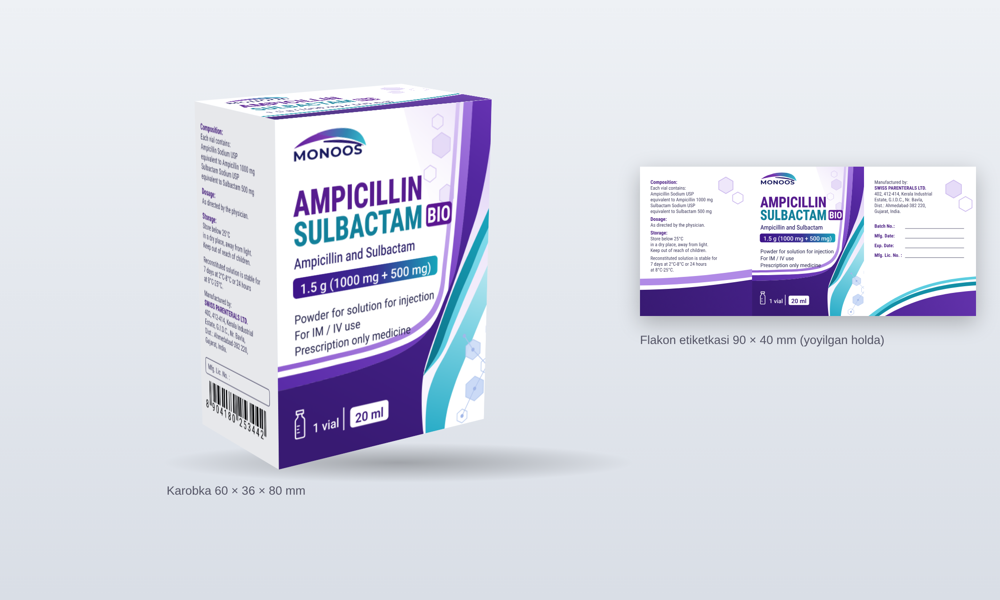

# MONOOS — Ampicillin + Sulbactam BIO karobkasi (vektor)

Rasmdagi binafsha-moviy karobka va flakon etiketkasi detallarga ajratilib, vektor qilib
qayta chizilgan: logo, fon (to'lqinlar, oltiburchaklar), matnlar, shtrix-kod, har bir panel
va qutining to'liq razvyortkasi (kesish va bukish chiziqlari bilan).

Maket va o'lchamlar [Cefoperazone karobkasi](../monoos-cefoperazone-sulbactam-karobka/) bilan
bir xil, faqat ranglar va matnlar boshqa.

## Papkalar

| Papka | Ichida |
|---|---|
| `0-korinish/` | 3D maket va razvyortka rasmi (faqat ko'rish uchun) |
| `1-logo/` | MONOOS logosi (binafsha-moviy yoy): oddiy va to'q fonda ishlatiladigan oq varianti |
| `2-fon/` | Fonlar matnsiz: old panel foni, 2-yon panel foni (3 mm vylet bilan) |
| `3-matn/` | Faqat matn qatlamlari (fonsiz): old panel matni + logo, yon panel matni, EAN-13 shtrix-kod |
| `4-panellar/` | Har bir panel to'liq holda: old, yon (tarkib), yon-2 (brend), yuqori va pastki qopqoq |
| `5-flakon-etiketka/` | Flakon etiketkasi 90 × 40 mm: foni alohida va to'liq |
| `6-razvyortka/` | Qutining to'liq razvyortkasi, bosmaxonaga beriladigan fayl |

Har bir detal 3 xil formatda:
- **SVG** — CorelDRAW / Illustrator'da tahrirlash uchun (qatlam va guruhlar nomlangan);
- **PDF** — vektor, aniq mm o'lchamda;
- **PNG** — 300 dpi, tez ko'rish uchun.

## O'lchamlar

| Detal | O'lcham |
|---|---|
| Karobka (eni × chuqurligi × bo'yi) | 60 × 36 × 80 mm |
| Old / orqa panel | 60 × 80 mm |
| Yon panellar | 36 × 80 mm |
| Qopqoq tilchasi / yon qanotchalar / yelim qanoti | 15 / 20 / 14 mm |
| Vylet (bleed) | 3 mm |
| Flakon etiketkasi | 90 × 40 mm (20 ml flakon, Ø ≈ 30 mm) |
| Razvyortka listi | 230 × 206 mm |

Razvyortkada: **qizil chiziq** — kesish, **ko'k punktir** — bukish.
Qatlamlar: `FON`, `LOGO`, `MATN`, `KESISH-CHIZIG-I`, `BUKISH-CHIZIQLARI`, `IZOHLAR-CHOP-ETILMAYDI`.

## Ranglar (HEX)

| Element | Rang |
|---|---|
| AMPICILLIN | `#561C8E` |
| SULBACTAM | `#13809A` |
| BIO belgisi | `#5A1690` |
| To'q binafsha to'lqin | `#381A72` → `#6633B2` |
| Binafsha / lavanda lentalar | `#7A44C4`, `#B591E6` |
| Moviy (teal) lentalar | `#138FA6`, `#5CCDE0` |
| Doza plashkasi | `#3E1489` → `#17A6BB` |
| Logo yoyi | `#5E1E98` → `#38C4D4` |
| Logo yozuvi | `#1A1B5E` |
| Oddiy matn | `#23224A` |
| Yon panel matni / sarlavhalar | `#3E3B5C` / `#4E2385` |

Ranglar RGB'da. Bosmadan oldin CorelDRAW'da CMYK'ga o'tkazing.

## Shriftlar

Hamma matnlar **konturga (curves) aylantirilgan**. Matnni qayta yozish kerak bo'lsa,
bepul Google Fonts shriftlari: **Roboto Condensed** (dori nomi, BIO, yon panel),
**Roboto** (qolgan matnlar), **Montserrat** Bold (MONOOS logosi).

## E'tibor bering

- **Orqa panel** rasmda ko'rinmaydi, shuning uchun old panel takrorlandi.
  **2-yon panel**, **yuqori va pastki qopqoq** ham shu uslubda qo'shildi.
  Pastki qopqoqda seriya va sanalar uchun bo'sh maydonlar bor (Batch No., Mfg. Date, Exp. Date).
- **Shtrix-kod** `8904180253442` rasmdan olingan. U **Cefoperazone karobkasidagi kod bilan bir xil**:
  har bir mahsulotning o'z kodi bo'lishi kerak, bosmadan oldin haqiqiy kodga almashtiring.
- Karobka o'lchami (60 × 36 × 80 mm) va razvyortka shakli taxminiy. Kesish shtampini
  karton qalinligiga qarab **bosmaxona bilan tasdiqlang**.
- Yon paneldagi matnlar (tarkib, saqlash, ishlab chiqaruvchi) rasmdagidek ko'chirilgan.

## Qayta yaratish

Generator skriptlari umumiy papkada: [`../monoos-karobka-skript/`](../monoos-karobka-skript/).
Bu karobka `ampicillin` mahsuloti sifatida yaratiladi.
