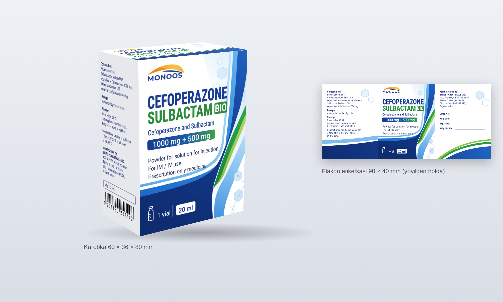

# MONOOS — Cefoperazone + Sulbactam BIO karobkasi (vektor)

Rasmdagi karobka va flakon etiketkasi detallarga ajratilib, vektor qilib qayta chizilgan:
logo, fon (to'lqinlar, oltiburchaklar), matnlar, shtrix-kod, har bir panel va qutining
to'liq razvyortkasi (kesish va bukish chiziqlari bilan).



## Papkalar

| Papka | Ichida |
|---|---|
| `0-korinish/` | 3D maket va razvyortka rasmi (faqat ko'rish uchun) |
| `1-logo/` | MONOOS logosi: oddiy va to'q fonda ishlatiladigan oq varianti |
| `2-fon/` | Fonlar matnsiz: old panel foni, 2-yon panel foni (3 mm vylet bilan) |
| `3-matn/` | Faqat matn qatlamlari (fonsiz): old panel matni + logo, yon panel matni, EAN-13 shtrix-kod |
| `4-panellar/` | Har bir panel to'liq holda: old, yon (tarkib), yon-2 (brend), yuqori va pastki qopqoq |
| `5-flakon-etiketka/` | Flakon etiketkasi 90 × 40 mm: foni alohida va to'liq |
| `6-razvyortka/` | Qutining to'liq razvyortkasi, bosmaxonaga beriladigan fayl |
| `_manba-skript/` | Fayllarni qayta yaratuvchi skriptlar (o'lcham yoki matnni o'zgartirish uchun) |

Har bir detal 3 xil formatda:
- **SVG** — CorelDRAW / Illustrator'da tahrirlash uchun (qatlam va guruhlar nomlangan);
- **PDF** — vektor, aniq mm o'lchamda;
- **PNG** — 300 dpi, tez ko'rish uchun.

## O'lchamlar

| Detal | O'lcham |
|---|---|
| Karobka (eni × chuqurligi × bo'yi) | 60 × 36 × 80 mm |
| Old / orqa panel | 60 × 80 mm |
| Yon panellar | 36 × 80 mm |
| Qopqoq tilchasi / yon qanotchalar / yelim qanoti | 15 / 20 / 14 mm |
| Vylet (bleed) | 3 mm |
| Flakon etiketkasi | 90 × 40 mm (20 ml flakon, Ø ≈ 30 mm) |
| Razvyortka listi | 230 × 206 mm |

Razvyortkada: **qizil chiziq** — kesish, **ko'k punktir** — bukish.
Qatlamlar: `FON`, `LOGO`, `MATN`, `KESISH-CHIZIG-I`, `BUKISH-CHIZIQLARI`, `IZOHLAR-CHOP-ETILMAYDI`.

## Ranglar (HEX)

| Element | Rang |
|---|---|
| CEFOPERAZONE, logo yozuvi | `#1A3D91` |
| To'q ko'k to'lqin | `#0E2C6F` → `#1F63C2` |
| SULBACTAM, BIO belgisi | `#2C8C3D` / `#2E8B3E` |
| Yashil lentalar | `#23994A`, `#8DC63F` |
| Ko'k / och ko'k lentalar | `#1F77D3`, `#8CC8F2` |
| Logo yoyi | `#EE7F1A` → `#F8B330` |
| Oddiy matn | `#1E2D5C` |
| Yon panel matni | `#22307A` |

Ranglar RGB'da. Bosmadan oldin CorelDRAW'da CMYK'ga o'tkazing.

## Shriftlar

Hamma matnlar **konturga (curves) aylantirilgan**, shuning uchun shrift o'rnatilmagan
kompyuterda ham to'g'ri ochiladi. Matnni qayta yozish kerak bo'lsa, quyidagi bepul
Google Fonts shriftlari ishlatilgan:

- **Roboto Condensed** ExtraBold / Bold / Regular: dori nomi, BIO, yon panel matni;
- **Roboto** (Regular, Medium, SemiBold): qolgan matnlar;
- **Montserrat** Bold: MONOOS logosi.

## E'tibor bering

- **Orqa panel** rasmda ko'rinmaydi, shuning uchun old panel takrorlandi.
  **2-yon panel**, **yuqori va pastki qopqoq** ham rasmda yo'q, ular shu dizayn uslubida qo'shildi.
  Pastki qopqoqda seriya va sanalar uchun bo'sh maydonlar bor (Batch No., Mfg. Date, Exp. Date).
- **Shtrix-kod** `8904180253442` rasmdan olingan, nazorat raqami to'g'ri va skanerda o'qiladi.
  Bosmadan oldin mahsulotning haqiqiy ro'yxatdan o'tgan kodiga almashtiring.
- Karobka o'lchami (60 × 36 × 80 mm) va razvyortka shakli taxminiy. Kesish shtampini
  karton qalinligiga qarab **bosmaxona bilan tasdiqlang**.
- Yon paneldagi matnlar (tarkib, saqlash, ishlab chiqaruvchi) rasmdagidek ko'chirilgan.

## Qayta yaratish (o'lcham yoki matnni o'zgartirish)

`_manba-skript/build_box.py` boshida `W, D, H` (mm) va matnlar bor. Shriftlarni
(`RobotoCondensed[wght].ttf`, `Roboto[wdth,wght].ttf`, `Montserrat[wght].ttf`)
github.com/google/fonts dan yuklab, bitta papkaga qo'ying:

```bash
pip install fonttools uharfbuzz cairosvg
```

```bash
python3 _manba-skript/build_box.py fonts .
```

```bash
python3 _manba-skript/make_pdf.py .
```

PNG va 3D maket uchun (Node.js + Playwright kerak): `node _manba-skript/render.js . --png --dpi=300`
va `node _manba-skript/mockup.js . 0-korinish/3d-maket.png`.
